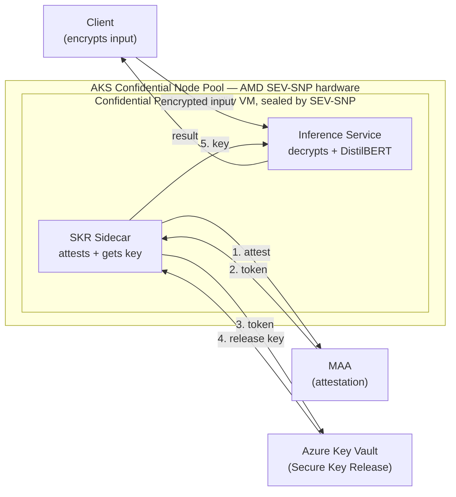

# SYSTEM ARCHITECTURE AND DESIGN 
- The system follows a single-service, containerized architecture on Kubernetes, deployed as a confidential container
 and the wokload running inside a hardware sealed enclave and encrypted by the processor
- Also the design is minimal and it contain two main parts **one inference service plus one security helper (the SKR sidecar)**, rather than having a broad microservice system.As our goal is to This is a obvious choice the goal of the POC is to prove a security property (that data is only ever readable inside the enclave), not to build a large distributed application. Keeping the architecture small means the trust chain is easy to reason about, easy to demonstrate, and has a small surface area to secure.

# SYSTEM BLOCK DESIGN

