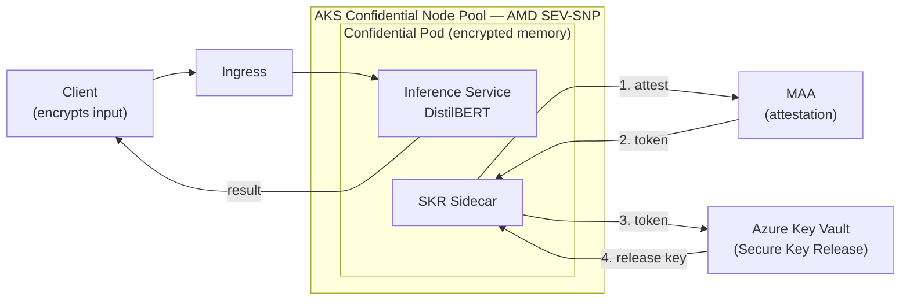
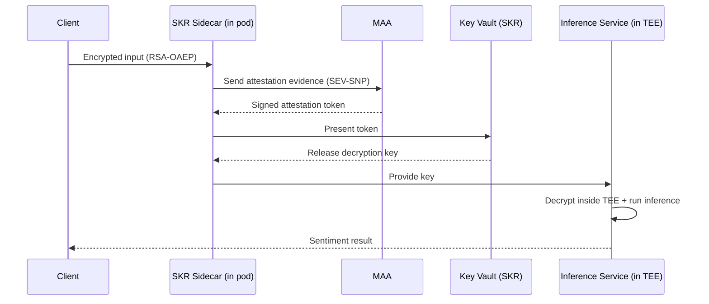
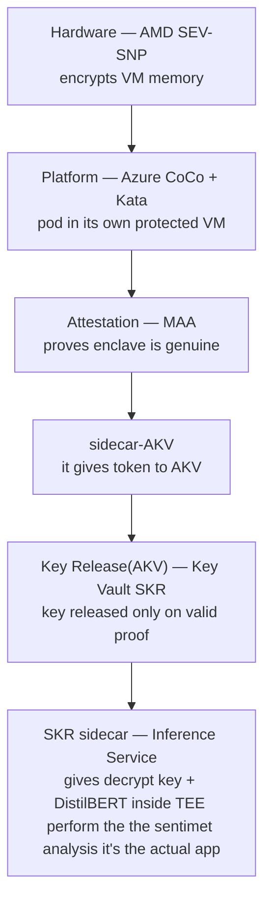

# SYSTEM ARCHITECTURE AND DESIGN 
- The system follows a single-service, containerized architecture on Kubernetes, deployed as a confidential container
 and the wokload running inside a hardware sealed enclave and encrypted by the processor
- Also the design is minimal and it contain two main parts **one inference service plus one security helper (the SKR sidecar)**, rather than having a broad microservice system.As our goal is to This is a obvious choice the goal of the POC is to prove a security property (that data is only ever readable inside the enclave), not to build a large distributed application. Keeping the architecture small means the trust chain is easy to reason about, easy to demonstrate, and has a small surface area to secure.

# SYSTEM BLOCK DESIGN

# LINK BETWEEN ATTESTATION AND KEY RELEASE

# LAYERS FLOWCHART END-TO-END

# DEPLOYMENT ARCHITECTURE 
- set up an AKS cluster with a special confidential floor (SEV-SNP machines), deploy your app there as a sealed pod, and wire it to three Azure services — one to prove the pod is genuine, one to release the key, and one to store the app's image. Once deployed, the pod proves itself, gets the key, and safely processes encrypted requests from clients.
- create the cluster → add the confidential floor → store the app image → deploy the pod there → connect it to attestation, key vault, and registry → and it's ready to processed the recieve encryption request by client 
